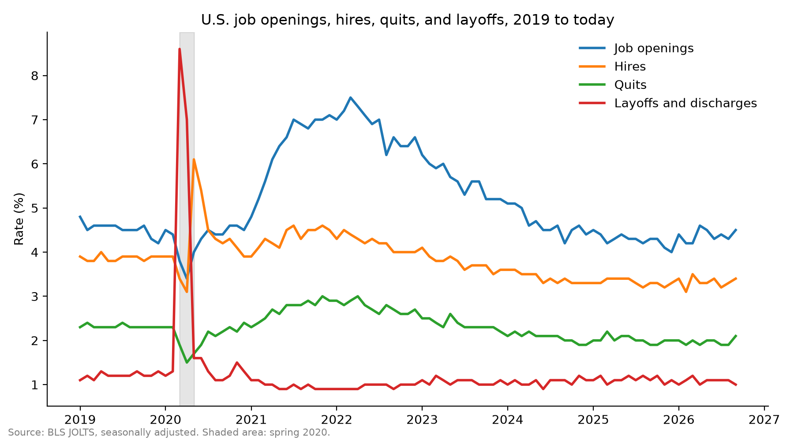
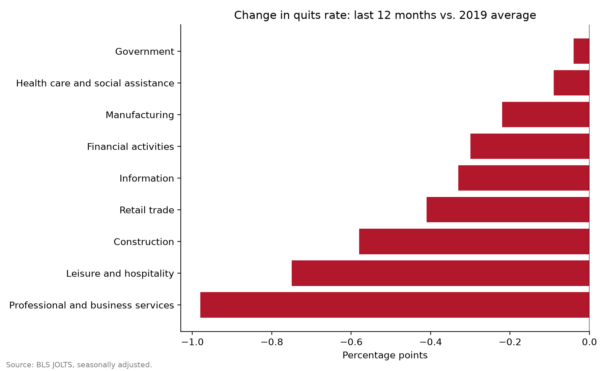
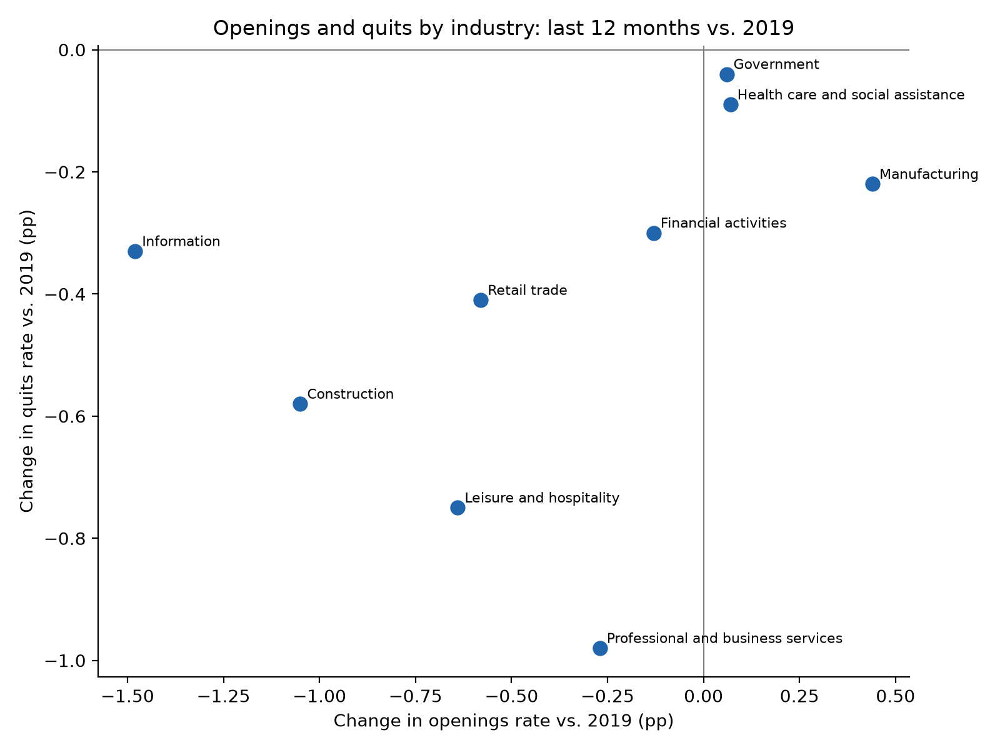

# Is the Great Stay Ending? Quits, Hires, and Job Openings by Industry, 2019 to Today

**Chinekwu Paulin Enwonwu** · Ph.D. Candidate in Economics, Northeastern University · [chinekwu-enwonwu.github.io](https://chinekwu-enwonwu.github.io)

After the record wave of quitting in 2021 and 2022, U.S. workers have been staying put. This project uses the
Bureau of Labor Statistics Job Openings and Labor Turnover Survey (JOLTS) to measure how far hiring, quitting, and
job openings have moved from their pre-pandemic levels, and which industries have cooled the most.

## Findings

**Is the Great Stay ending? Not yet. U.S. workers are quitting less than they did before the pandemic, and employers are hiring less too.**

Over the 12 months through September 2026, the quits rate averaged 2.0%, below its 2019 average of 2.3% and well
below the 2.8% of 2022. Quitting is a useful measure of worker confidence: people leave a job when they expect to
find a better one. By that measure, workers are more cautious today than they were before the pandemic.

The bigger change is in hiring. The hires rate averaged 3.3%, down from 3.9% in 2019. Job openings, at 4.3%, are
only slightly below their 2019 level of 4.5%, after falling sharply from 6.8% in 2022. Employers are still posting
jobs at close to pre-pandemic rates, but they are filling fewer of them. With layoffs also low, at 1.1% compared
with 1.2% in 2019, the result is a "low-hire, low-fire" labor market. Workers who have jobs are holding on to them,
and job seekers have a harder time getting hired.

The drop in quitting is largest in professional and business services, where the quits rate is 0.98 percentage
points below its 2019 average. Government has barely changed, at 0.04 points below 2019. Measured from 2022,
leisure and hospitality has cooled the most, with its quits rate down 1.58 points as the post-pandemic wave of job
switching in restaurants and hotels has faded.

Low quitting often signals slower wage growth, since changing jobs is one of the main ways workers get raises.
Whether the Great Stay ends will depend on hiring. If employers start filling more of their openings, quitting is
likely to pick up again.

*Data through September 2026. The two most recent months are preliminary and may be revised.*







Interactive versions of each chart (Plotly) are in the `figures/` folder as `.html` files.

## Data and methods

- **Source:** BLS JOLTS, seasonally adjusted rates, January 2019 to the latest month, downloaded through the
  [BLS Public Data API](https://www.bls.gov/developers/). The latest two months are preliminary.
- **Industries:** total nonfarm plus nine major industries.
- **Comparisons:** the average over the most recent 12 months versus the 2019 average (pre-pandemic) and the
  2022 average (peak quitting).
- **Tools:** Python (pandas, matplotlib, Plotly).

## How to run

```bash
pip install -r requirements.txt
jupyter notebook great_stay_jolts.ipynb
```

Run all cells. The notebook downloads the data (two API requests), saves it to `data/`, and writes the charts to
`figures/`. To refresh with new data, delete `data/jolts_raw.json` and run again.

## Files

- `great_stay_jolts.ipynb`: download, cleaning, analysis, and charts
- `data/`: raw API response, tidy data, and summary table (created when the notebook runs)
- `figures/`: charts as PNG and interactive HTML (created when the notebook runs)
